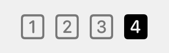

# Yabai Spaces

[](https://github.com/DavidPurvis/yabai-spaces/actions/workflows/ci.yml)
[](LICENSE)

**Know which desktop you're on—and which apps are on the others.**

A small native macOS menu-bar companion for [yabai](https://github.com/asmvik/yabai), with numbered desktop indicators inspired by AeroSpace's `i3Ordered` style. No replacement menu bar, widget framework, or additional strip across the screen.



*Illustrative rendering from the app's own renderer, not a menu-bar screenshot.*

## At a glance

- Every existing Mission Control Space gets a number, including empty desktops.
- The current Space is filled; inactive ones are dimmed.
- Click to see apps and window counts grouped by desktop and display.
- Read-only native fallback when yabai isn't reachable.
- Optional yabai/skhd configuration: spiral tiling, five memorable shortcuts, and centered floating windows covering approximately **50% of usable screen area**.
- No network requests, telemetry, window screenshots, or bundled third-party packages.

The menu is informational: it does **not** switch desktops, move windows, or replace yabai. These are real macOS Spaces, not AeroSpace's virtual workspaces.

## Quick start

Requires macOS 13+, Xcode Command Line Tools (`xcode-select --install`), and Python 3.9+ for installation and optional helpers. The native app is built for your Mac's architecture. It has been exercised on Apple Silicon/macOS 26.6.2 with yabai 7.1.16 and skhd 0.3.9; other macOS versions and Intel hardware are not yet manually verified.

```sh
git clone https://github.com/DavidPurvis/yabai-spaces.git
cd yabai-spaces
sh scripts/build.sh
python3 scripts/install.py
```

This installs the menu-bar app for your user and starts it at login. It does **not** change yabai/skhd settings. The build is locally signed, not notarized; build from source rather than treating it as a signed binary distribution. No `sudo` is needed.

To also install the included tiling settings and shortcuts, first read [Setup](docs/SETUP.md), then use:

```sh
python3 scripts/install.py --with-configs
```

If any destination already exists—including the app from the first command—the installer refuses to overwrite it. Add `--replace` only after reviewing the changes. Previous files are saved in a timestamped backup. Symlinked dotfiles and higher-priority yabai/skhd config files require a manual merge.

## Memory jog

| Shortcut | Action |
|---|---|
| ⌥ Return | New Terminal window |
| ⌥ F | New Finder window at your home folder |
| ⌥ V | New Visual Studio Code window |
| ⌥ S | New Safari window |
| ⌥ ⌘ F | Toggle floating; center and enlarge when entering floating mode |

Floating windows use **70.7% of the usable width × 70.7% of the usable height**, approximately half the usable area. Existing floating windows keep their size until centered again. Application minimum-size limits can affect the result.

## Documentation

- [Setup, updates, backups, and removal](docs/SETUP.md)
- [All shortcuts, settings, and maintenance commands](docs/REFERENCE.md)
- [Architecture, privacy, compatibility, and tests](docs/DEVELOPMENT.md)
- [Contributing](CONTRIBUTING.md) · [Changelog](CHANGELOG.md)

## Development

```sh
python3 -B -m unittest discover -s tests -v
sh scripts/build.sh
build/YabaiSpaces.app/Contents/MacOS/YabaiSpaces --self-test
```

GitHub Actions runs the tests and native build on macOS. Automated checks do not prove real window placement, multi-monitor behavior, or Space-switching animation; those need a logged-in desktop session.

## Limitations

The fallback uses private, read-only WindowServer APIs and can break after a macOS update. Its app lists may omit minimized or hidden windows. Native fullscreen Spaces appear in the numbered sequence, and Mission Control reordering can change the numbers. A large number of Spaces can crowd the menu bar, especially on notched displays. Details: [compatibility notes](docs/DEVELOPMENT.md#compatibility-and-known-limits).

## Credits and license

Independently implemented, with visual inspiration from [AeroSpace's menu-bar indicator](https://github.com/nikitabobko/AeroSpace/blob/v0.21.3-Beta/Sources/AppBundle/ui/MenuBarLabel.swift). Built to complement [yabai](https://github.com/asmvik/yabai) and [skhd](https://github.com/asmvik/skhd); not affiliated with those projects. macOS supplies the numbered symbols at runtime.

[MIT](LICENSE) © 2026 David Purvis.
